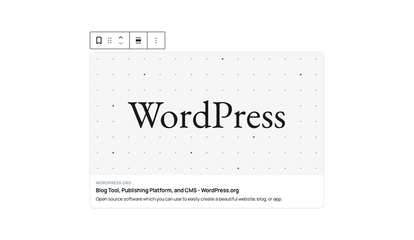

# Better Bookmarks

[](https://github.com/philhoyt/BetterBookmarks/actions/workflows/ci.yml)

A WordPress block that fetches Open Graph metadata from a URL and renders a link preview card.



## Requirements

- WordPress 6.5 or later, with the block editor (the Classic Editor is not supported)
- PHP 7.2 or later
- Node.js 22 or later to build from source

## Installation

Download `better-bookmarks.zip` from the [Releases page](https://github.com/philhoyt/BetterBookmarks/releases) and install it from Plugins > Add New Plugin > Upload Plugin.

To install from a checkout, run `npm install && npm run build` first; the plugin registers the block from `build/` and does nothing without it. Updates are offered from GitHub releases through Plugin Update Checker.

## Usage

Add the Link Card block from the inserter, paste a URL into the placeholder, and press Enter. The block calls the REST endpoint below, stores the result in its attributes, and renders the card server-side from `src/blocks/link-card/render.php`. The editor preview is not clickable; the front-end card opens the URL in a new tab.

Four block styles: Default, Compact (thumbnail beside the text), Compact Stacked (thumbnail above the text, with a max width control), and Minimal (domain and title only).

After a preview has loaded, the Styles tab in the block inspector has:

- Aspect ratio, from the theme's registered ratios (the same list as the core Image block). Default 1.91:1.
- Image fit: cover or contain.
- Typography, color, border, shadow, and spacing block supports.

The block also has a transform from the core Embed block that carries the URL over and fetches the preview.

### TMDb for IMDb links

IMDb blocks server-side requests, so for IMDb URLs the endpoint can read title, description, and poster from TMDb instead. Enter a TMDb API key under Settings > Better Bookmarks, or define it in `wp-config.php` (the constant takes precedence and the settings field becomes read-only):

```php
define( 'BETTER_BOOKMARKS_TMDB_API_KEY', 'your-key-here' );
```

## REST API

`GET /wp-json/better-bookmarks/v1/preview?url={url}`

Requires the `edit_posts` capability. The URL must be http or https and must not resolve to a private, loopback, or reserved IP range. The page request has a 10-second timeout and reads at most 2 MB.

```json
{
  "url": "https://example.com",
  "title": "Page title",
  "description": "OG or meta description, cut to 200 characters.",
  "image": "https://example.com/image.jpg",
  "domain": "example.com",
  "imageWidth": 1200,
  "imageHeight": 630
}
```

Title and description fall back to `<title>` and `<meta name="description">` when the Open Graph tags are missing. Image dimensions come from `og:image:width` and `og:image:height`; when those are missing, the endpoint fetches the first 32 KB of the image (5-second timeout) and reads the header. If that fails too, both dimensions are `0` and the block uses the 1.91:1 default.

## Development

```bash
npm install
composer install   # also copies Plugin Update Checker into lib/ via the copy-puc script
```

```bash
npm start              # webpack watch
npm run build          # production build into build/
npm run lint           # lint:js (ESLint) and lint:css (Stylelint)
npm run test:js        # Jest, src/blocks/link-card/test/
composer run lint      # phpcs, WordPress Coding Standards
composer run lint:fix  # phpcbf
composer run test      # PHPUnit with Brain\Monkey stubs, tests/php/
npm test               # test:js then test:php
npm run plugin-zip     # builds better-bookmarks.zip
```

Source lives in `src/blocks/link-card/`; the build writes to `build/`. The PHP tests stub WordPress with Brain\Monkey rather than loading a WordPress install. CI (`.github/workflows/ci.yml`) runs `composer audit`, phpcs, and PHPUnit on PHP 7.3 through 8.4, then lints, builds, and runs the Jest tests on Node 22. The plugin header allows PHP 7.2, but `composer.lock` is pinned to a 7.3 platform, so CI starts at 7.3.

## Releases

Bump the version in `better-bookmarks.php` (header and `BETTER_BOOKMARKS_VERSION`), `package.json`, `src/blocks/link-card/block.json`, and the `Stable tag` in `readme.txt`, add the changelog entry, then push a lowercase `v` tag:

```bash
git tag v1.2.1 && git push origin v1.2.1
```

The release workflow (`.github/workflows/release.yml`) runs `npm ci`, builds, runs `npm run plugin-zip`, and publishes a GitHub release with `better-bookmarks.zip` and `readme.txt` attached and GitHub's generated release notes as the body. The tag must use a lowercase `v`: Plugin Update Checker strips the prefix case-sensitively, so a `V1.2.1` tag is never offered as an update.

## Limitations

- Metadata is fetched at edit time and stored in block attributes. The card does not update when the linked page changes.
- The page is fetched server-side, so content injected by JavaScript is not seen.
- Meta tags are parsed with regular expressions, not a DOM parser. Malformed HTML can make extraction fail without an error.
- No caching. Each fetch is a live HTTP request.
- The description is cut at 200 characters on the server.
